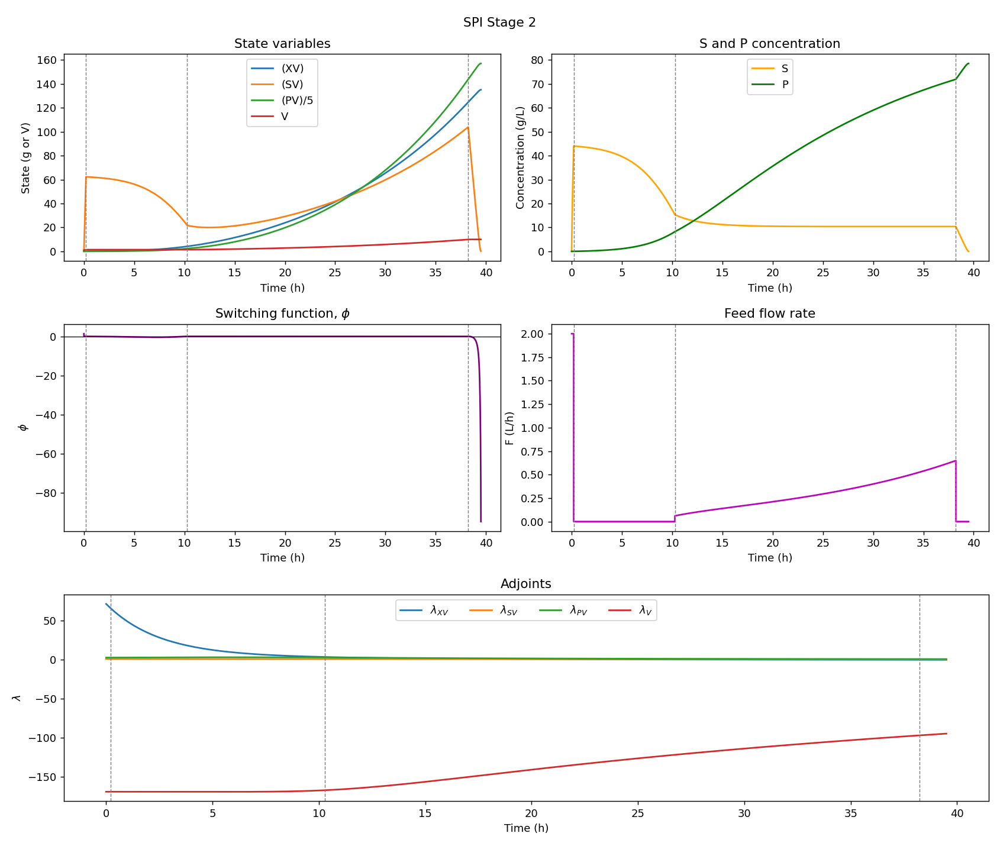

# Singulax


<<<<<<< HEAD

=======


>>>>>>> 504775a (update README.md)


**Optimal feeding policies for fed-batch fermentation, computed from Pontryagin's Maximum
Principle — including the singular arcs where the maximum principle on its own determines
nothing.**

Singulax solves the fed-batch bioreactor problem *"how should I feed substrate over time to
maximise product at harvest?"* Because the feed rate enters the dynamics linearly, the optimal
policy is a sequence of arcs — full feed, no feed, and **singular** arcs on which the classical
optimality condition degenerates. Those singular arcs are where the interesting behaviour lives
(the feed tracks the culture so that substrate is held at its productivity-optimal level), and
they are also what makes the problem numerically awkward.

The approach here is a **two-stage hybrid direct → indirect method**: a robust low-accuracy
direct solve discovers the arc structure and seeds the adjoints, then an indirect PMP shooting
solve refines everything to machine precision. Every derivative in the pipeline — costate
equations, Lie brackets, the singular feed law, sparse NLP Jacobians — is obtained by automatic
differentiation, so switching to a new kinetic model means writing three rate functions and
nothing else.

Built on [JAX](https://github.com/google/jax), [diffrax](https://github.com/patrick-kidger/diffrax),
[optimistix](https://github.com/patrick-kidger/optimistix) and IPOPT.

---

## Contents

- [The optimal control problem](#the-optimal-control-problem)
- [Where it gets singular](#where-it-gets-singular)
- [The two-stage hybrid method](#the-two-stage-hybrid-method)
- [Results](#results)
- [Case studies](#case-studies)
- [Installation](#installation)
- [Usage](#usage)
- [Repository layout](#repository-layout)
- [Implementation notes](#implementation-notes)
- [Status and known issues](#status-and-known-issues)
- [References](#references)

---

## The optimal control problem

The reactor is described by four *extensive* states $x = [XV,\ SV,\ PV,\ V]^T$ — biomass,
substrate and product masses, and the working volume. The feed rate $F(t)$ is the only control,
and it enters **affinely**:

$$
\dot{x} = f(x) + g(x)\,F,
\qquad
f(x) = \begin{bmatrix} \mu\,XV \\ -\sigma\,XV \\ \pi\,XV \\ 0 \end{bmatrix},
\qquad
g = \begin{bmatrix} 0 \\ S_F \\ 0 \\ 1 \end{bmatrix}
$$

where the specific rates $\mu$ (growth), $\sigma$ (substrate uptake) and $\pi$ (productivity)
are functions of the intensive concentrations $S = SV/V$ and $P = PV/V$, and $S_F$ is the feed
substrate concentration. The problem is

$$
\max_{F(\cdot)} \; PV(t_f)
\qquad \text{s.t.} \qquad
0 \le F(t) \le F_{\max}, \quad V(t) \le V_{\max}
$$

Introducing the adjoint $\lambda$, the Hamiltonian $H = \lambda^T\!\left(f(x) + g\,F\right)$ is
**linear in $F$**, with

$$
\phi \;:=\; \frac{\partial H}{\partial F} \;=\; S_F\,\lambda_{SV} + \lambda_V,
\qquad
\dot{\lambda} = -\frac{\partial H}{\partial x}
$$

$\phi$ is the *switching function*, and maximising $H$ gives

| condition | optimal feed |
|---|---|
| $\phi > 0$ | $F = F_{\max}$ (bang) |
| $\phi < 0$ | $F = 0$ (batch) |
| $\phi \equiv 0$ on an interval | **singular — undetermined** |

## Where it gets singular

When $\phi$ vanishes over a whole interval rather than at isolated points, the maximum condition
reduces to $0 = 0$ and says nothing about $F$. The control has to be recovered by differentiating
the condition along the trajectory: $\phi = \dot{\phi} = \ddot{\phi} = 0$. Solving $\ddot{\phi}=0$
for $F$ gives the singular feedback law

$$
F_{\mathrm{sing}} \;=\; -\,\frac{\lambda^T\,[f,[f,g]]}{\lambda^T\,[g,[f,g]]},
\qquad [a,b] = \frac{\partial b}{\partial x}a - \frac{\partial a}{\partial x}b
$$

Rather than deriving these Lie brackets by hand for each kinetic model, Singulax builds them with
`jax.jacobian` directly from `f_vec` and `g_vec` (`Fsin.py` in each case subpackage). The same
applies to the costate RHS, which is `-jax.grad` of the Hamiltonian rather than a hand-transcribed
Jacobian.

**Everything downstream of the rate functions is autodiffed:**

| quantity | how |
|---|---|
| costate dynamics $\dot\lambda = -\partial H/\partial x$ | `jax.grad` of $H$ |
| Lie brackets $[f,g]$, $[f,[f,g]]$, $[g,[f,g]]$ | `jax.jacobian` |
| sparse collocation Jacobian | `jax.jacrev` on per-step blocks, scattered into COO |
| batch-phase terminal costate | `jax.grad` through a `diffrax` solve |

So a new organism or kinetic model means writing $\mu$, $\sigma$ and $\pi$; the singular law,
adjoints and Jacobians follow for free.

## The two-stage hybrid method

Neither classical approach works alone here. A pure **indirect** (shooting) method needs an
initial guess for the unmeasurable adjoints *and* prior knowledge of the arc sequence — neither of
which you have. A pure **direct** (transcription) method converges from a crude guess but smears
the switching times and gives a low-accuracy feed profile. So the two are chained:

```
                    ┌───────────────────────────────────────┐
  crude guess ─────►│  STAGE 1 — direct                     │
                    │  forward-Euler transcription + IPOPT   │
                    └───────────────┬───────────────────────┘
                                    │
                    arc sequence ───┤  (bang / singular / batch,
                                    │   from detect_switches)
                    λ(0) seed ──────┤  (= −constraint multipliers)
                                    │
                    ┌───────────────▼───────────────────────┐
                    │  STAGE 2 — indirect                    │
                    │  PMP multiple shooting (Levenberg–     │
                    │  Marquardt) over nodes + switch times  │
                    └───────────────┬───────────────────────┘
                                    │
                                    ▼
                       extremal, ‖residual‖ ~ 1e-12
```

### Stage 1 — direct transcription (`src/fedopt/collocation.py`)

The trajectory is discretised on $N$ intervals into a decision vector
$z = [x_0,\dots,x_N,\ F_0,\dots,F_{N-1}]$, and IPOPT minimises $-PV(t_f)$ subject to the
forward-Euler defects $x_{k+1} - x_k - h\,f(x_k,F_k) = 0$. The Jacobian is assembled sparsely:
each defect touches only $x_k$, $x_{k+1}$ and $F_k$, so only those blocks are autodiffed and
scattered into a COO matrix.

This stage is first-order accurate and deliberately not trusted for the answer. Two things are
harvested from it:

- **the arc sequence** — `detect_switches` labels every node as a bang at $F_{\max}$, a bang at
  $F_{\min}$/batch, or interior (singular), debounces runs shorter than `min_dwell` to kill
  numerical flicker, and returns the switch times;
- **the costate seed** — the NLP's equality-constraint multipliers *are* the discrete costates,
  up to sign ($\lambda \leftarrow -\texttt{mult\_g}$, the sign coming from minimising $-PV$).

### Stage 2 — indirect PMP shooting (`shooting.py` in each case subpackage)

With the structure fixed, the OCP becomes a multi-point boundary value problem. The unknowns are
the state–costate vectors at the shooting nodes plus the switch times; the residual stacks

1. continuity defects across each arc,
2. the initial condition $x(0) = x_0$,
3. transversality on the free terminal states,
4. $V(t_M) = V_{\max}$ — the tank-full condition that pins the singular exit,
5. $\phi = 0$ at every interior switch node,
6. $\dot{\phi} = 0$ at the singular entry (tangential entry onto the singular surface).

`optimistix.LevenbergMarquardt` drives the residual to zero, refining the switch times and
adjoints simultaneously.

## Results

The substrate + product inhibition case (Shin & Lim's ethanol fermentation) exercises the full
pipeline end to end. Stage 1 reads the structure off a 400-interval Euler solve; Stage 2 converges
to

```
Stage 2 ||res||    = 4.8e-12
Stage 2 switches   = [0.208, 10.275, 38.235] h
PV(tf)             = 785.08 g            (Shin & Lim report 764.47 g for this case)
batch λ(tf)        = [0, 0, 1, -94.71]   (expected form [0, 0, 1, η], η free)
```



*States, intensive concentrations, switching function, feed profile and adjoints for the converged
$F_{\max} \rightarrow 0 \rightarrow F_{\mathrm{sing}} \rightarrow \text{batch}$ policy. Note
$\phi \equiv 0$ across the singular arc and its sharp departure once the tank fills at
$t = 38.2$ h.*

## Case studies

Two kinetic models, worked through control structures of increasing difficulty. Each script is
self-contained and writes its figures next to itself.

### Substrate inhibition — Haldane kinetics

$\mu(S) = \mu_{\max}S/(K_s + S + S^2/K_i)$, so growth is maximised at $S^\star=\sqrt{K_sK_i}$.
This case has a **closed-form singular feed**, $F = \sigma(S^\star)\,XV/(S_F - S^\star)$, which
serves as ground truth for the numerics.

| control structure | analytical | indirect (PMP) | hybrid |
|---|---|---|---|
| $F_{\mathrm{sing}}$ (starting on the singular surface, $S_0 = S^\star$) | [`ana_si_sing.py`](scripts/substrate_inhibition/singular_arc/analytical_sol/) | [`pmp_si_sing.py`](scripts/substrate_inhibition/singular_arc/analytical_and_pmp/) | [`hybrid_si_sing.py`](scripts/substrate_inhibition/singular_arc/hybrid_approach/) |
| $F_{\mathrm{sing}} \rightarrow$ batch (tank fills) | [`ana_si_sing_and_batch.py`](scripts/substrate_inhibition/singular_arc_and_batch/analytical_sol/) | [`pmp_si_sing_and_batch.py`](scripts/substrate_inhibition/singular_arc_and_batch/analytical_and_pmp/) | [`hybrid_si_sing_batch.py`](scripts/substrate_inhibition/singular_arc_and_batch/hybrid_approach/) |
| $F_{\max} \rightarrow F_{\mathrm{sing}} \rightarrow$ batch (starting below $S^\star$) | [`ana_si_bang_sing_batch.py`](scripts/substrate_inhibition/bang_singular_arc_and_batch/analytical_sol/) | [`pmp_ana_si_bang_sing_batch.py`](scripts/substrate_inhibition/bang_singular_arc_and_batch/haldane_model/) | [`hybrid_si_bang_sing_batch.py`](scripts/substrate_inhibition/bang_singular_arc_and_batch/hybrid_approach/) |

### Substrate + product inhibition — Shin & Lim ethanol case

$\mu$, $\sigma$ and $\pi$ all depend on $S$ *and* $P$ (ethanol from glucose by *S. cerevisiae*,
example 13.E.3). No closed-form singular feed exists, so the Lie-bracket law is the only route.
Solved by the full hybrid pipeline in
[`hybrid_spi.py`](scripts/substrate_and_product_inhibition/hybrid_spi.py).

### Cart-pole benchmark

[`scripts/hybrid_example/`](scripts/hybrid_example/) reproduces Illustrative Example 1 of
Foroozandeh et al. (2018) — a finite-order singular problem with a bang–singular–bang structure.
It validates the method independently of any biology, and has its
[own detailed walkthrough](scripts/hybrid_example/README.md).

### Supporting analyses

[`scripts/substrate_inhibition/singular_arc_and_batch/others/`](scripts/substrate_inhibition/singular_arc_and_batch/others/)
holds the diagnostics behind the design decisions: `demo_instability.py` (why the batch costate
cannot be integrated forward), `sympy_adjoint_analysis.py` (symbolic PMP conditions and a
closed-form switch time), and a solver-by-solver forward-shooting comparison.

## Installation

Requires Python ≥ 3.12. [uv](https://github.com/astral-sh/uv) is used for dependency management.

```bash
git clone https://github.com/dtu-qmcm/singulax.git
cd singulax
uv sync
```

Stage 1 additionally needs **cyipopt**, the Python bindings to
[COIN-OR IPOPT](https://github.com/coin-or/Ipopt). It is not currently declared in
`pyproject.toml`, and it needs the native IPOPT library present, so install it separately:

```bash
uv pip install cyipopt
```

If the build fails, install IPOPT from your system package manager or conda-forge first — that is
the usual cause. Everything that does *not* use Stage 1 (the analytical and pure-PMP scripts) runs
without cyipopt.

## Usage

`uv sync` installs `fedopt` in editable mode, so scripts can be run directly:

```bash
uv run python scripts/substrate_and_product_inhibition/hybrid_spi.py
```

Each script prints its Stage-1 and Stage-2 diagnostics and writes PNG figures alongside itself.
To use the library directly:

```python
import jax
jax.config.update("jax_enable_x64", True)     # required — the shooting residuals need float64

from fedopt.collocation import CollocParams, objective, constraints, jac_defects, detect_switches
from fedopt.substrate_product_inhibition import get_phi, get_Fsin, vector_field
from fedopt.substrate_product_inhibition.shooting import solve_and_get_residuals_ms
```

Case-specific names (`mu`, `sigma`, `get_phi`, `get_Fsin`, `vector_field`, …) exist in **both**
case subpackages and are deliberately not re-exported at the top level — always import them from
the relevant subpackage.

## Repository layout

```
src/fedopt/
├── collocation.py                    Stage-1 direct machinery, shared by all cases:
│                                     CollocParams, Euler defects, sparse COO Jacobian,
│                                     detect_switches (arc-structure detection)
├── substrate_inhibition/             Haldane kinetics
│   ├── kinetics.py                   mu, pi, m_func, sigma
│   ├── odes.py                       f/g vectors, costate RHS, switching function phi
│   ├── Fsin.py                       singular feed via Lie brackets
│   ├── analytical.py                 closed-form reference feed + event conditions
│   └── shooting.py                   Stage-2 residuals, one per control structure
└── substrate_product_inhibition/     Shin & Lim ethanol kinetics
    ├── kinetics.py                   mu, sigma, pi  (functions of S and P)
    ├── odes.py                       as above, physical coordinates throughout
    ├── Fsin.py                       singular feed via Lie brackets
    └── shooting.py                   multiple-shooting residuals

scripts/
├── hybrid_example/                   cart-pole benchmark (+ its own README)
├── substrate_inhibition/
│   ├── singular_arc/                 ┐
│   ├── singular_arc_and_batch/       ├ each with analytical_sol/, analytical_and_pmp/
│   └── bang_singular_arc_and_batch/  ┘ and hybrid_approach/ variants
└── substrate_and_product_inhibition/ full hybrid pipeline
```

## Implementation notes

The non-obvious decisions, all of which cost real debugging time:

**The batch-phase costate cannot be integrated forward.** Once the feed stops and substrate
exhausts, the costate ODE has a strongly positive eigenvalue (~$641\ \mathrm{h}^{-1}$ for the
substrate-inhibition case). The true $\lambda_{SV}(0)$ of the batch arc sits roughly $10^{-167}$
below the equilibrium value — unrepresentable in float64 — so any forward integration immediately
diverges along the unstable mode. The batch arc is therefore **never a shooting segment**. Instead
it enters as a terminal cost, $\lambda(t_M) = \partial PV(t_f)/\partial x(t_M)$, computed by
`jax.grad` through a `diffrax` solve of the batch phase. `others/demo_instability.py` demonstrates
the failure on a two-line model.

**Two coordinate conventions coexist, on purpose.** The substrate-inhibition case carries the
state as $[XV, \log SV, PV, V]$ in places: the log keeps $SV$ strictly positive so the Stage-1
Euler NLP cannot drive it negative. But in log coordinates the NLP can "consume more substrate
than exists" ($SV = \exp(\cdot)$ is never negative), which produces an infeasible seed whenever
substrate actually exhausts. So cases with a terminal batch phase run Stage 1 in **physical** $SV$
with an explicit $SV \ge 0$ bound, while costates and Lie brackets are always evaluated in
physical coordinates. `l_to_orig` maps the $SV$-costate between the two.

**$V = V_{\max}$ is the singular-exit anchor.** Rather than leaving the singular→batch switch time
as a free unknown fixed by $\phi = 0$, the residual pins $V(t_M) = V_{\max}$. Since $V$ is at its
bound there, this replaces the $\lambda_V$ transversality condition and is far better conditioned.

**Sign convention.** $PV(t_f)$ is *maximised* here, so $H$ is maximised, $\dot\lambda =
-\partial H/\partial x$, and $\phi > 0$ selects $F_{\max}$. This is the opposite sign to Shin &
Lim, who minimise $-PV$ — worth remembering when comparing adjoint plots against the book.

**A machine-zero residual is not a proof of optimality.** It certifies that you found *an*
extremal satisfying the PMP conditions for the assumed arc structure. If the structure Stage 1
detected is wrong, Stage 2 will happily converge to the wrong thing. Always inspect the trajectory
and the switching function.

## Status and known issues

Active research code (v0.1.0). Both inhibition cases converge, and the substrate-inhibition cases
agree with their analytical references. Known rough edges:

- **`substrate_inhibition/Fsin.py` numerator is incomplete.** It computes only
  $(\partial[f,g]/\partial x)f$ and omits the second term $-(\partial f/\partial x)[f,g]$ of
  $[f,[f,g]]$ — the same omission already fixed in the SPI version. Applying the fix left
  $PV(t_f)$ unchanged but raised the shoot residual from ~3e-4 to ~4e-2, so it needs a re-tuned
  seed before being re-enabled (flagged in the source).
- `S_F` is hardcoded to `150.0` inside `get_phi` in both cases.
- `scripts/.../singular_arc_and_batch/others/forward_single_shooting.py` still imports the
  pre-reorganisation module paths (`fedopt.odes`, `fedopt.shooting`, `fedopt.si_analytical`,
  `fedopt.Fsin`) and will not run as-is.
- `cyipopt` and `jaxtyping` are used but not declared in `pyproject.toml`.
- No test suite yet, though pytest is configured.

## References

1. Foroozandeh, Z., Shamsi, M., & de Pinho, M. d. R. (2018). A Hybrid Direct–Indirect Approach for
   Solving the Singular Optimal Control Problems of Finite and Infinite Order.
   *Iranian Journal of Science and Technology, Transactions A: Science*, **42**(3), 1545–1554.
   [doi:10.1007/s40995-017-0176-2](https://doi.org/10.1007/s40995-017-0176-2)
   — the two-stage hybrid method and the cart-pole benchmark.
2. Shin, H. S., & Lim, H. C. *Fed-Batch Cultures*. Example 13.E.3 (ethanol from glucose by
   *S. cerevisiae*) — the substrate + product inhibition kinetics and the reference
   $PV(t_f) = 764.47$ g.
